# sigma-lint

sigma-lint reads Sigma rule files (YAML, one or several rules per file) and checks the rule metadata and the detection logic: required fields, a valid UUID id, status and level values, a condition that references only defined selections, selections that are never used, match-all values, ATT&CK tags and duplicate ids across a rule set. It is a quick pre-commit gate for a rules repository.



**Live demo:** https://jvch0512.github.io/sigma-lint/ (Synthetic data.)

Ruby 3 standard library only. The demo page is rendered from the tool's `--tsv` output by `scripts/site.py` (Python 3, only needed to regenerate the page).

## Use

```bash
bin/sigma-lint examples
bin/sigma-lint ./rules --tsv
bin/sigma-lint ./rules --fail-on high       # exit 1 on any high finding
```

Exit codes: 0 ok, 1 findings at or above `--fail-on`, 2 bad input. Output is human text by default and TSV with `--tsv` (`# N files, M findings`, then `SEVERITY<TAB>RULE<TAB>WHERE<TAB>MESSAGE`).

| Rule | Severity | What it catches |
|---|---|---|
| SIG001 | high | a missing title, logsource or detection, or a logsource with no category, product or service |
| SIG002 | high | a detection block with no condition |
| SIG003 | high | a condition that uses a selection name that is not defined |
| SIG004 | low | a selection that is defined but never used in the condition |
| SIG005 | medium | a missing or invalid UUID id |
| SIG006 | low | a missing level |
| SIG007 | low | a missing description or author |
| SIG008 | medium | a level or status value outside the Sigma specification |
| SIG009 | medium | a keyword selection that is only `*` and matches every event (`field: '*'` is the "field exists" idiom and is not flagged) |
| SIG010 | low | no tags, or an `attack.` tag that is not a technique or tactic |
| SIG011 | medium | the same id used by more than one rule in the scanned set |
| SIG012 | low | a missing falsepositives list |
| SIG000 | info | the file is not YAML or contains no rules |

See [examples](examples) and [docs/sample-output.txt](docs/sample-output.txt).

## Limits

- It checks structure and consistency, not whether a rule detects what it claims. It does not compile rules for any backend.
- Conditions are read with a small tokenizer: identifiers, `and`, `or`, `not`, parentheses and `1 of`, `all of` with wildcards or `them`. Aggregations after `|` are ignored.
- Correlation rules and rule collections that use `action: global` are checked rule by rule without merging the global document.
- Aliases in YAML are refused, and dates are read as plain values.

## Where it fits

Pre-commit and CI checks for a Sigma rules repository, and reviews of rule packs before they go into a SIEM.

## Tests

```bash
make test    # A minitest suite: every rule on good and bad Sigma documents, condition parsing, multi-document files, hostile YAML, fuzzing and CLI exit codes
```

MIT.

## Code scanning (SARIF)

`scripts/tsv2sarif.py` converts the `--tsv` output into SARIF 2.1.0, so findings show up in GitHub code scanning:

```sh
bin/sigma-lint examples --tsv | python3 scripts/tsv2sarif.py --tool sigma-lint --prefix examples > results.sarif
```

Upload `results.sarif` with `github/codeql-action/upload-sarif`. Severities map to SARIF levels (critical and high to error, medium to warning, low and info to note) and to a `security-severity` score.

## Validated on real data

This tool was run on public corpora and the false positives it produced were fixed. Corpus, counts and bugs found are in [docs/validation.md](docs/validation.md).
